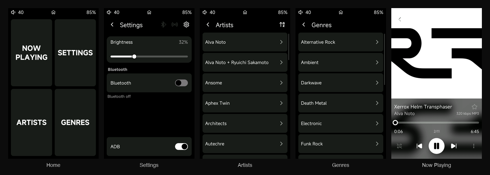

# R1 Minimal

HiBy R1 fork of [Jepl4r/sonix-player](https://github.com/Jepl4r/sonix-player).
Local library on microSD. B&W UI. Stock rootfs + replaced `sonix_player`.



## What it does

| Area | Capability |
|---|---|
| Home | Four tiles: Now Playing, Settings, Artists, Genres |
| Now Playing | Transport, queue position, cover, track metadata |
| Artists | artist → album → song |
| Genres | genre → artist → album → song (album = that artist’s full set) |
| Library | Tap Artists or Genres to scan; long-press either to rescan |
| Settings | Brightness, Bluetooth, USB modes |
| USB | MSC (card as disk, default) or ADB (shell); exclusive |
| Charge | Stock 80% limit (AXP REG64 ≈ 4.20 V) |
| Playback | Upstream Sonix decode + Bluetooth output |

## Flash

```text
build → sonix-packer → r1.upt on microSD root → bootmode.sh Recovery → reboot
```

Release asset: [`r1.upt`](https://github.com/ilia-murzinov/r1-minimal/releases/tag/v0.1.0).

Soft deploy (until reboot): `deploy/bind_min.sh` + `deploy/watch_min.sh`
bind-mounts over `/usr/bin/sonix_player`. Power cycle needs a real UPT flash.

## Credits

Upstream [Jepl4r/sonix-player](https://github.com/Jepl4r/sonix-player) (GPL-3.0).

[@Tartarus6](https://github.com/Tartarus6) ·
[@noisetta](https://github.com/noisetta) ·
[@endgame47](https://github.com/endgame47) ·
[@hkhrithik007](https://github.com/hkhrithik007)
