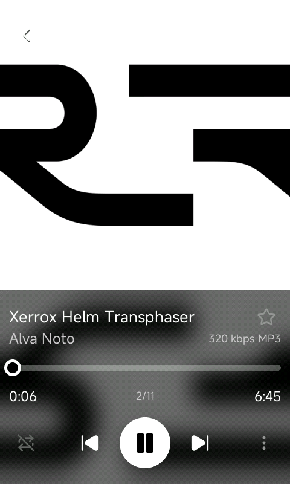
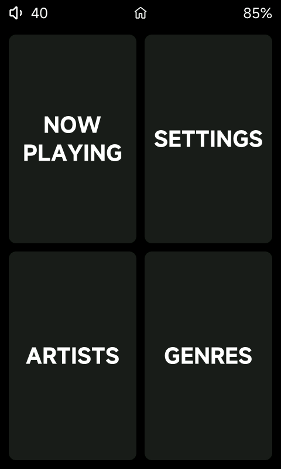
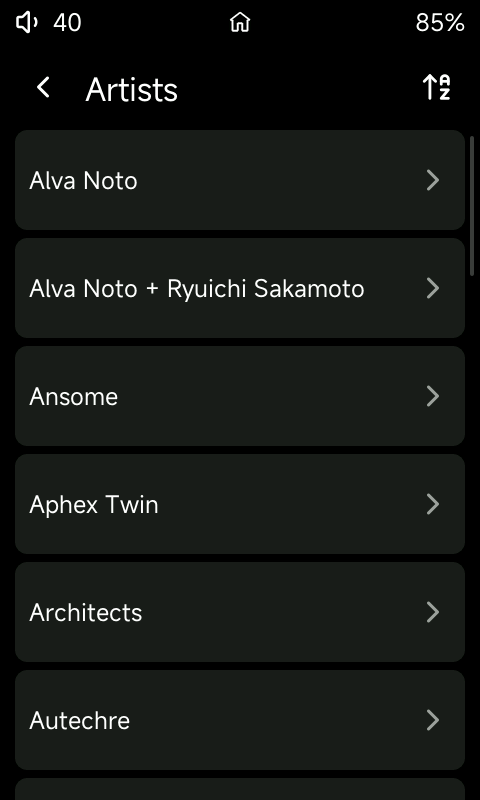
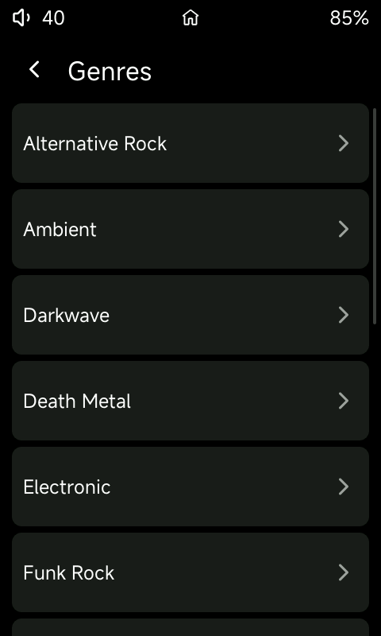
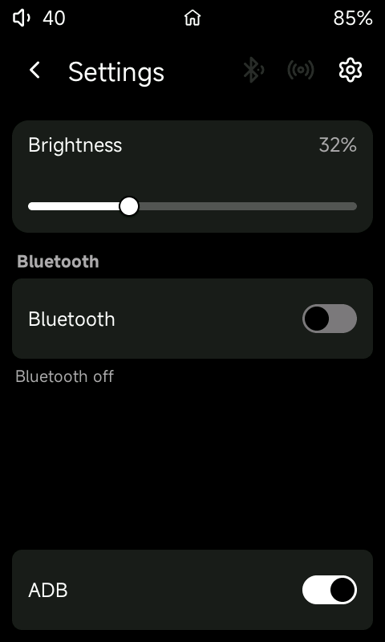

# R1 Minimal

My HiBy R1 build of [Sonix](https://github.com/Jepl4r/sonix-player) — cut down
for a local library on a microSD card. Play music, find it by artist or genre,
pair Bluetooth, flip USB between disk and ADB. That’s about it.

Stock HiBy and full Sonix carry a lot I don’t use. This keeps the B&W player
and drops the rest.

<p align="center">
  
  &nbsp;
  
</p>

Home is four big tiles: **Now Playing**, **Settings**, **Artists**, **Genres**.
Artists go artist → album → song. Genres go genre → artist → album → song
(each album is that artist’s full set). Empty card? Tap Artists or Genres to
scan; long-press either to rescan.

<p align="center">
  
  &nbsp;
  
  &nbsp;
  
</p>

Settings is short on purpose: brightness, Bluetooth, and **ADB** stuck at the
bottom (MSC is the default so the card shows up as a disk). ADB and MSC don’t
run together.

Charge stops at HiBy’s stock **80%** limit. Decode and Bluetooth are still
upstream Sonix — no graphic EQ / PEQ / MSEB here.

Not in this build: streaming, Wi‑Fi, AirPlay, DLNA, the big Settings hub,
browser, search, playlists UI, coverflow, games, ebooks.

## Flash

The binary replaces HiBy’s player on the stock R1 rootfs. `sonix-packer/`
unwraps a stock `r1.upt`, drops `sonix_player` in, and builds a new image.

```text
build → packer → r1.upt on the microSD root → bootmode.sh Recovery → reboot
```

Grab `r1.upt` from the
[release](https://github.com/ilia-murzinov/r1-minimal/releases/tag/v0.1.0).
Soft bind over ADB (`deploy/bind_min.sh`) dies on a full power cycle — flash
again for that.

## Credits

Upstream: [Jepl4r/sonix-player](https://github.com/Jepl4r/sonix-player)
(GPL-3.0).

Thanks to [@Tartarus6](https://github.com/Tartarus6),
[@noisetta](https://github.com/noisetta),
[@endgame47](https://github.com/endgame47),
[@hkhrithik007](https://github.com/hkhrithik007), and everyone in that
community.
